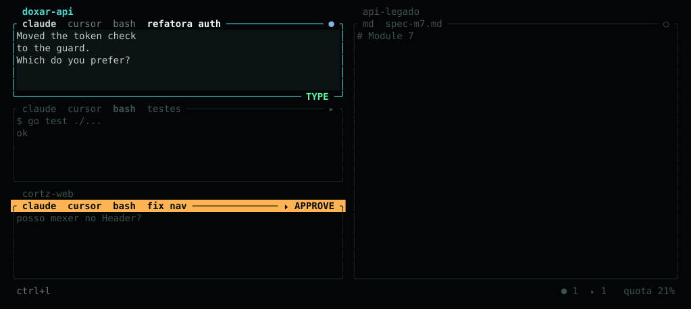

# Manual

## How it works

There are exactly **three things**.

### Project

A directory. Born together with its first cell — creating a project and creating a cell are
the same gesture — and **leaves the screen when its last cell dies**. The disk is never
touched: the project leaving the screen doesn't delete, move or change anything.

### Cell

The unit of work. **One rule for all of them**: the same key creates, kills, renames,
focuses and navigates any of them.

Creating doesn't ask what the cell is going to be. A **session** is born with four tabs
inside, all in the project's directory, and `tab` switches between them. Only the tab
you're using has a process: the others come up when you get to them.

| Tab | What it is |
|---|---|
| `claude` | Claude Code |
| `cursor` | Cursor CLI |
| `bash` | a shell |
| `md` | the project's markdown files: a list with search by name, and the chosen one rendered |

The `md` tab opens on a list of every markdown file in the project, with a **search bar at
the top**. Enter TYPE mode (`↵`), type part of the name to filter, `↑↓` picks and `↵` opens
the file. `esc` goes back to the list. The open file reloads itself when the disk changes —
you can watch the agent writing the spec right beside it.

The document is drawn **as a page, not as terminal output**: fixed, centered reading width,
margins on both sides, title in a banner, sections with a rule, blockquote with a bar,
table with a thin ruler and code in its own box. A code line wider than the page is
**cut with `›`**, never wrapped — a diagram split down the middle isn't readable.

When the agent in a Claude Code cell writes or edits a markdown file, the mosaic's status
line says `m reads plan.md` while that cell has the focus. `m` switches the cell to its `md`
tab already on that file — no list, no search — and the hint is gone once it's been read.

There are also two cell types that aren't sessions:

| Type | What it is |
|---|---|
| `logs` | live log of a compose service, created by the Docker panel |
| `md` | a specific markdown file, when you fill the MD field at creation |

Every cell has a state, and the state is the **glyph that ends the cell's top line** — the
same column on every cell, so the whole grid reads down one edge. Every state has a glyph
of its own and a color, so that neither is indispensable. There is no word beside it: the
words are in the help (`?`, under STATES), and here:

| Glyph | State | What to do |
|---|---|---|
| `▸` | working: live process producing | nothing — let it work |
| *(none)* | a Claude Code agent sitting at its prompt: nothing running, nothing unread | nothing — it's waiting for you to ask |
| `⬤` | responded: gave back its turn, has a response waiting to be read | read when you can; nothing is blocked |
| `⏵ APPROVE` | stuck on a question and **won't move** without an answer | answer: the work stopped here |
| `✖` | crashed: the process died on its own | `r` brings it back up |
| `○` | stopped: no process, cell preserved | `r` resumes from where it stopped |
| `◐` | interrupted: you stopped the turn, or declined what it asked. No notice: whoever stopped it was looking | ask again when you want; the next turn clears it |
| `◌` | background: the conversation was sent to a Claude Code background session (`←` on an empty prompt); the cell shows the list of agents | `↵` enters the cell, `Esc` there brings the conversation back — and from then on the mosaic follows it as before: its turns, `p`, and the conversation a restart resumes |
| `⚠` | orphaned: the project's directory disappeared from disk — every cell of the project shows it, whatever its process is doing, until the path is back (checked every 10 s) | recreate the path or kill the cell |

`⏵ APPROVE` is the only one written out, the only one that turns into a **solid bar filling
the whole top line** of the cell, and the only one that **blinks** — 1.8s on, 200ms off,
forever, while someone is waiting on you. The others are a glyph, still. It's on purpose:
urgency here is filled area, not hue — it works from a distance, works out of the corner of
your eye and works with no color at all.

In the off frame the bar **stays a bar**: only the background changes. The filled area is
what says "this is blocking the work", and it never disappears. And the clock only exists
while there's a blocked cell — with none, the screen stays completely still.
`TESSERACT_NO_BLINK=1` turns off the blink for those who prefer a still screen.

**Responded ≠ approve.** That's the distinction that makes the alarm worth something: an
agent stuck on a question blocks the work; an agent that finished its turn just has
something to read.

**Idle and interrupted come from the agent itself.** They exist only for a Claude Code
cell with the mods loaded, which says what its session is doing. A cell read from the
outside — cursor, or Claude Code with `mods` off — can't tell a quiet prompt from a quiet
turn, and keeps showing `▸` there, as it always did.

### Approving without entering the cell

When the focused cell is blocked on a **tool's permission dialog**, the status line — the
last line of the screen, which at rest is just `?` — says what is waiting and what the keys
do:

```
 ⏵ Bash: pnpm migrate   Enter approves   Esc declines   ctrl+l enters
```

While that line is on screen — and only then — `Enter` approves and `Esc` declines, from
the mosaic, without TYPE. The rule has no surprise in it:

- The offer has to have been there to be read. "Arrow, `Enter`" is how a cell is entered:
  for the first 0.6 s after the line shows up, `Enter` and `Esc` do nothing — neither
  approve nor enter — so landing on a blocked cell and pressing `Enter` in the same burst
  never approves a command nobody saw.

- It only happens for what the cell's mod reported as a tool approval. A **question with
  options** and a **plan to review** aren't a yes or no: the status line says `↵ enters the
  cell to answer`, and `Enter` enters the cell as usual.
- An approve read off the screen (no mod: cursor, the folder-trust question, `mods` off)
  keeps the usual status line and the usual `Enter`. Nobody said what that one is asking.
- `ctrl+l` enters TYPE whatever the cell is waiting on — to pick "yes, and don't ask
  again", or to tell the agent what to do instead. The same key gives the keyboard back.
- Scrolled back into the cell's history, the line goes away and `Esc` returns to the live
  end first.
- The engine checks again when the key arrives: if the dialog is already gone, nothing is
  typed into the cell and the status line says so.

And **no false alarms**: a blinking spinner and a moving cursor don't count as activity.
The engine requires consecutive reads of work before arming the alert, and consecutive
reads of silence before declaring the turn over.

### Picking the folder

Creation opens on a **folder browser**, not on an empty path, with the focused project's
folder already in the field — the common case is another cell right there, and `↵` takes
it. With nothing typed the list
is the **directories opened most recently** — they stay on the list after the project
leaves the screen, which is exactly when they're worth the most — and `↑↓` picks one. A
fragment with no slash in it filters that history: `dox` finds the project without anyone
remembering where it lives.

Anything with a slash in it goes to disk instead, and the list refreshes **as you type**,
with no completion key. `→` walks into the picked folder, `←` climbs back out, and `↵`
settles the folder and moves on to the name. Nothing here requires a full path typed by
hand — a whole project can be picked with the arrows alone.

### Docker panel

Belongs to the **project**, not the cell. The compose file is looked for at the root and in
first-level folders — because a real project keeps its stack in `docker/`, `infra/` and
the like — and **a production file is never chosen**. The panel lists the services with
state, port, health and uptime (a column no service fills isn't drawn), and its keys on one
short line — what each does at length is in the help (`?`); brings up, stops, restarts and rebuilds a service or the
whole stack; and turns a service's log into a mosaic cell.

While Docker is working, the panel says what it's doing and keeps updating the list — the
services flip to `▸ up` one at a time instead of everything changing at once at the end. A
service that exited on an error reads `✖`, one stopped cleanly `○`: the same glyphs as a cell.

**No destructive action exists here.** There's no `down -v`, no deleting a volume.

This panel is the only Docker panel there is. Inside a Claude Code cell the Docker mod adds
what a panel can't do, and nothing to look at: every `docker` the agent runs through Bash
goes past a guard that refuses whatever deletes a volume, an image or the build cache; the
agent gets two tools, to list the services and to restart one; and `/dlog api` puts the
last 20 log lines of `api` in the prompt, unsent, for you to finish the sentence (`/dlog`
alone lists the services).

### Open in the IDE

`ctrl+e` lists every IDE found on the machine — VS Code, VS Code Insiders, VSCodium and
Cursor, installed in WSL or on the Windows side — and `↵` opens the project's directory in
the picked one. When the agent in the focused Claude Code cell has edited a file, the
picker gains a line of its own: `f` opens `internal/cell/md.go:42`, the last file it
touched, at the line. The IDE is started on its own, tied to nothing of the engine's: the
shortcut comes back at once and the window outlives the screen closing.

## The two modes

<p align="center">
  
</p>

By default you're in **BROWSE**: every key belongs to the app. Nothing on the screen says
so — it's the screen at rest, with `?` alone on the status line.

`↵` enters **TYPE**: every key belongs to the cell, **with no exception whatsoever**. Not
`q`, not `D`, not `tab`, not the arrows. `ctrl+l` gives back the keyboard.

Pasting (`ctrl+v`, or whatever your terminal uses) works in TYPE mode and in text fields.
The text goes in **marked as a paste**: a multi-line prompt enters whole into the agent's
box, instead of each line break becoming a send. In a single-line field — the project's
path, the `p` prompt — the paste gets flattened into one line.

There's never two owners of the keyboard at the same time — so shortcut collision is
structurally impossible. And the mode is impossible to get wrong, because it changes
**four** things at once:

1. the screen background darkens;
2. every other cell loses its project's color and dims — only the cell with the keyboard
   keeps its line lit;
3. that cell's bottom line ends in the word ` TYPE `, in **phosphor green** — the only
   phosphor green on the screen;
4. the status line changes from `?` to `ctrl+l`, the one key that isn't the cell's.

The line around the cell doesn't change shape: every box is the same thin line with rounded
corners. With `NO_COLOR=1` signal 1 disappears and the others stay — the word and the key
are text, and the dimming becomes the terminal's own faint.

## Copying what the agent wrote

With the mosaic, the terminal's own selection doesn't work: it grabs the neighbors and the
borders too. So the mark is Tesseract's own. **Drag the mouse over the cell** — the section
lights up — and **release**: the text goes to the clipboard, with no color and no trailing
spaces at the end of lines. Works in both modes and both drag directions. `esc` clears the
mark.

Clicking without dragging only picks the cell; it doesn't touch whatever you'd copied
before. To grab something that already scrolled off screen, **scroll first** (mouse wheel)
and then drag — the mark works on what's in view.

## Configuration

Optional, at `~/.config/tesseract/config.json`. Without the file, everything works with the
defaults.

```json
{
  "sound": true,
  "notify": true,
  "notifyCommand": "",
  "historyLimit": 5242880,
  "scrollbackLines": 2000,
  "sleepAfterMinutes": 15,
  "mods": true,
  "roster": false,
  "claudeTheme": "dark-ansi",
  "dockerDeny": true,
  "agents": {
    "claude": {
      "program": "claude",
      "args": ["--model", "opus"],
      "renameCommand": "/rename"
    }
  }
}
```

`scrollbackLines` is how far back a cell can be scrolled without touching the recorded
history. Every one of those lines stays in memory fully styled: ten thousand of them cost
around a hundred megabytes **per cell**, and a project with several tabs open pays that
many times over. Two thousand is eighty screens of reading — searching further back is
what the recording on disk is for.

`sleepAfterMinutes` is how long an agent tab **out of view** can stay silent before its
process is released. Nothing is lost: coming back to the tab brings the agent up again on
the same conversation. A tab holding a question is never released, and neither is a shell —
what's running in there is yours, and silence in a shell doesn't mean idleness. Zero turns
it off and keeps every tab you ever opened resident.

`mods` loads Tesseract's mods into every Claude Code cell. It's through them that the
agent itself says what its turn is doing, so the cell knows it's waiting for approval
because Claude Code said so — and the notice tells you *what* is waiting ("requested
approval: Bash: pnpm migrate"). Turn it off and the cell goes back to being read from the
outside, by the text on its screen. Nothing else changes: the same happens by itself for a
cursor cell, or a Claude Code too old to load a mod.

The mods draw no panel of their own. The mosaic is where every panel lives — it's reachable
from any cell and it isn't squeezed into the cell's sixteen lines — and each mod keeps only
what can't be done from outside the session:

| Mod | What it does inside a cell |
|---|---|
| `tesseract-link` | turn state, the conversation's id, usage, and prompts sent from the mosaic |
| `tesseract-skin` | the brand inside the session |
| `tesseract-docker` | the guard on destructive `docker` commands, two tools for the agent, `/dlog` |
| `tesseract-md` | tells the mosaic a markdown was written — the status line's `m` |
| `tesseract-ide` | tells the mosaic the last file edited and the line — the picker's `f` |
| `tesseract-roster` | not loaded in a cell: it's for a `claude` running outside Tesseract |

`claudeTheme` is the theme Claude Code starts with inside a cell. `dark-ansi` draws with
your terminal's own sixteen colors, which is what makes the agent speak the grid's
palette (see `themes/claude-code.md`). It's passed on the command line, so it holds for
the cell and your theme outside Tesseract stays as you left it. An empty string leaves
the theme alone; so does passing your own `--settings` in `args`.

`roster` loads the `tesseract-roster` mod inside cells. It's off by default: the mosaic
already says who's calling, and the roster inside a cell said it a second time. The other
mods aren't affected.

`dockerDeny` starts every Claude Code cell with native permission rules
(`permissions.deny`, on the same `--settings`) for the Docker commands that delete data:
`docker compose down -v` / `--volumes` / `--rmi`, the same under `docker-compose`,
`docker volume rm` / `prune`, `docker system prune`, the `container` / `image` /
`network` / `builder` prunes and `docker rm -v`. It's a second layer under the
`tesseract-docker` mod's guard, and it holds in a session that skips permission prompts.
A rule matches the command's text, so the same command behind `sh -c`, a full path or a
global flag is the guard's to stop; and `docker compose down` alone matches none of them.
Passing your own `--settings` in `args` turns this off along with the theme.

With the mods on, a prompt sent from the mosaic without entering the cell is delivered
as your own message and queued behind whatever is running, instead of being typed into
the terminal. Renaming works the same way.

The **quota** of the 5-hour window shows up at the right end of the status line by itself
as soon as a Claude Code cell has measured it: `quota 12%`, and from 80% up in amber with
the time it rolls over (`quota 86% · 0:41`). It stays one figure: the 7-day window takes its
place (`7d 91%`) only when it's past 80% and ahead of the 5-hour one. How full a
conversation's own context window is belongs to the cell, and shows on its top line
(`ctx 86%`) only from 80% up. Without the mods the figure falls back to the old way: your
Claude Code statusline writes `~/.claude/tesseract-quota.json` (or the old
`squad-quota.json`) in the format `{"used_percentage": 59, "resets_at": 1786955400}`. With
neither, everything still works — the figure just doesn't show up.

The mod has three switches of its own, in Claude Code's `/config`: **Detalhe na
notificação** (off, the notice goes back to a plain "approve" and no text of
the conversation leaves the session), **Quota no mosaico**, and **Resumo de uma linha**
(off by default: at the end of each turn the cheapest model writes the answer in up to 60
characters, which sits before the `⬤` on the cell's top line and goes into the notice; it costs one short model call per turn and holds the notice for up to
6 s).

## Who runs inside a cell

Inside a cell Claude Code doesn't repeat what the mosaic already says: the skin draws no
band above the prompt there (project, cell, state and quota are on the mosaic), it marks a
turn with the mosaic's glyph and no word (`▸ thinking · 12s`, `⬤ 42s`, `◐ 4s`), and the
roster stays out.

Every process Tesseract starts gets `TESSERACT=1` in the environment, and
`TESSERACT_CELL=<project>/<cell>` with the name the cell was born with (a later rename
doesn't reach a process that's already running). It can't paint an
agent's interface — what the cell shows is what the process wrote, and nothing more. What
it can do is say "you're in here", and let whoever cares dress accordingly.

Claude Code's statusline is the typical case: it's a command of yours, runs inside the
cell's pty, inherits the environment and can open the line with `⧉` and use Tesseract's
palette when the variable is set. Outside Tesseract, nothing changes — the brand
introduces itself, it doesn't impose itself.

```bash
[ -n "${TESSERACT:-}" ] && echo "this session is inside a cell"
```
